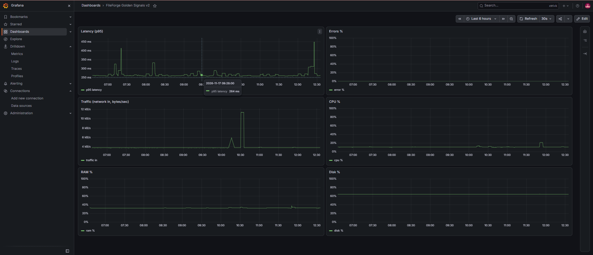
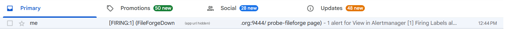
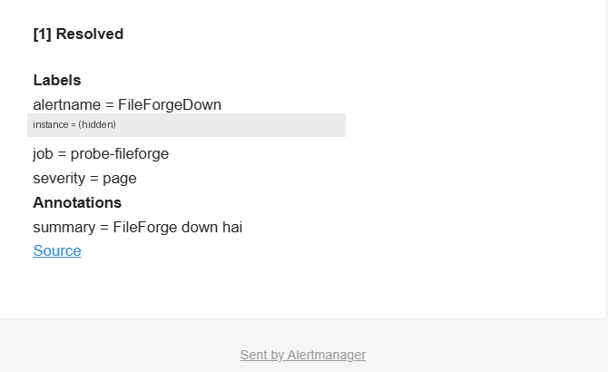
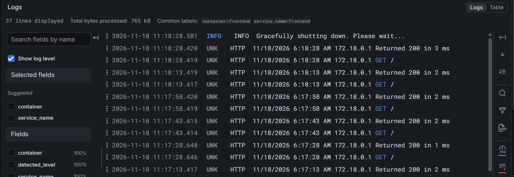

# SRE on FileForge

Hands-on SRE practice on my own containerized app (**FileForge**): service levels, alerting, an incident drill, a Golden Signals dashboard, and centralized logging.



## What I built

| Area | What | Tools |
|---|---|---|
| SLI | Availability and latency measured by an external HTTP probe | Blackbox Exporter, Prometheus |
| SLO / SLA | SLO **99.2%**, SLA **99%** | Prometheus recording rules |
| Error budget | **0.8%** (about 5.7 hours per 30 days) with burn-rate alerts (14.4x page, 6x ticket) | Prometheus alert rules |
| Alerting | FIRING and RESOLVED emails | Alertmanager + Gmail SMTP |
| Monitoring | 4 Golden Signals: latency, traffic, errors, saturation | Grafana, node-exporter, cAdvisor |
| Logging | Container logs searchable next to metrics | Loki + Alloy + Grafana |

## Architecture

```
App server                         Monitoring server
-----------                        -----------------
FileForge containers  --logs-->    Loki  <--  Grafana
Alloy (log shipper)                Prometheus + Blackbox + Alertmanager
node-exporter, cAdvisor --metrics-> Prometheus
```

Two servers: one runs the app, the other watches it. The probe checks the app from the outside, like a real user would.

## Failure drill (incident management)

I stopped the frontend container on purpose and followed the incident lifecycle: detect, triage, respond, mitigate, resolve, postmortem.

| Time | Event |
|---|---|
| T+0 | `docker stop frontend` |
| about T+2 min | `FileForgeDown` and `AvailabilityFastBurn` alerts reach my inbox (**MTTD about 2 min**) |
| triage | probe fails, error ratio rises, budget turns negative, SEV1 |
| mitigate | `docker start frontend` |
| resolve | probe back to 1, RESOLVED email received |

**Alert emails**





**Logs explain the "why".** The metrics said the app was down. Loki showed the frontend shut down gracefully, and the 15-second probe requests stopped right after:



## Repo layout

```
monitoring/   Prometheus, Blackbox, SLO rules, Alertmanager (example only)
loki/         Loki log store
alloy/        Alloy log shipper (runs on the app server)
grafana/      Golden Signals dashboard JSON (import in Grafana)
docs/         Notes and screenshots
```

## Run it

1. **Monitoring server:** `docker compose up -d` in `monitoring/` and in `loki/`.
2. Copy `monitoring/alertmanager.yml.example` to `alertmanager.yml` and fill in your Gmail and a Gmail App Password. This file is git-ignored, never commit it.
3. **App server:** `docker compose up -d` in `alloy/` (set the Loki IP in `config.alloy`).
4. In Grafana add Prometheus and Loki data sources, then import `grafana/fileforge-golden-signals.json`.

## What I learned

- Metrics tell you **what** is broken. Logs tell you **why**. You need both.
- An error budget turns "is it reliable enough?" into a number you can act on.
- Test your alerts by breaking things on purpose, before a real outage does.

## Next

Toil and automation, capacity planning, chaos testing, release safety, backup and disaster recovery.
